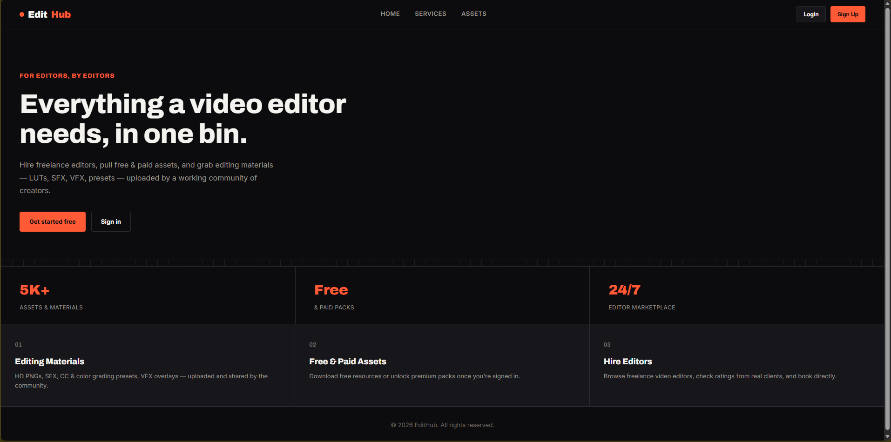
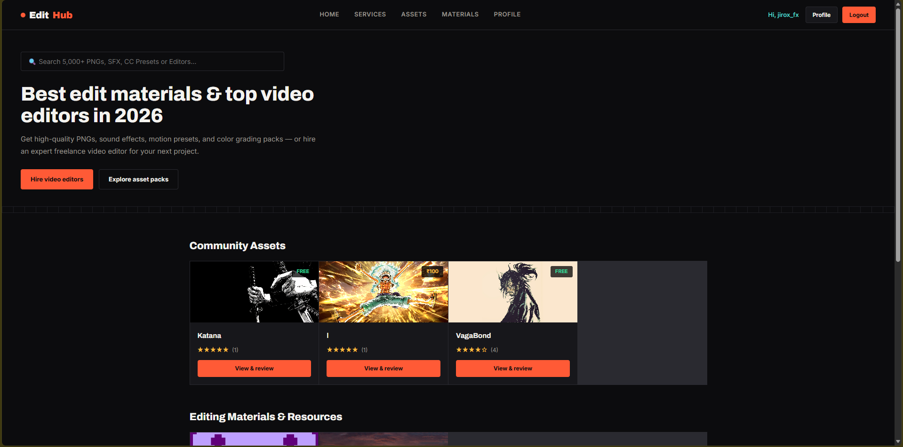
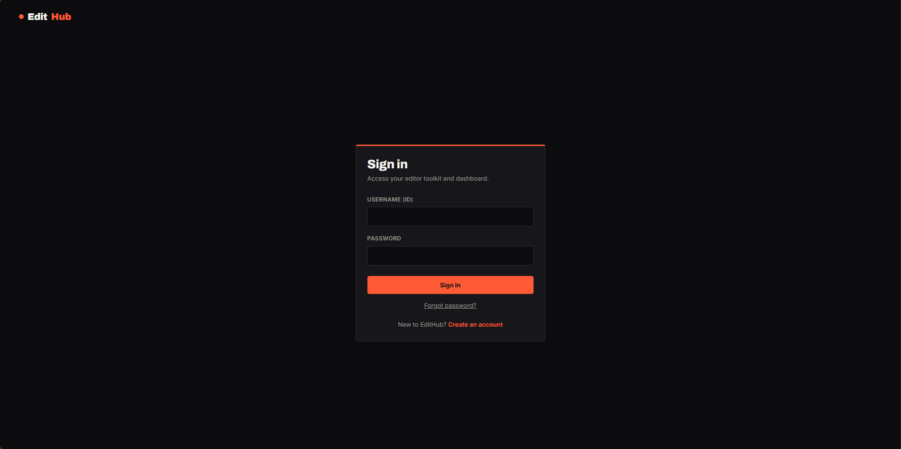
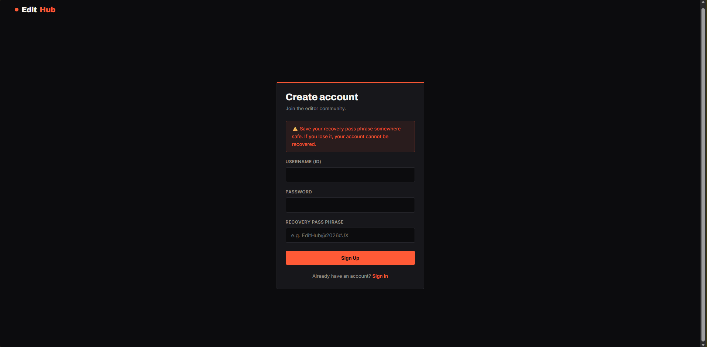
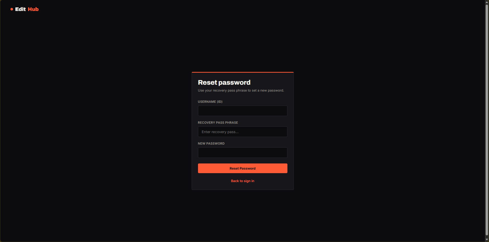
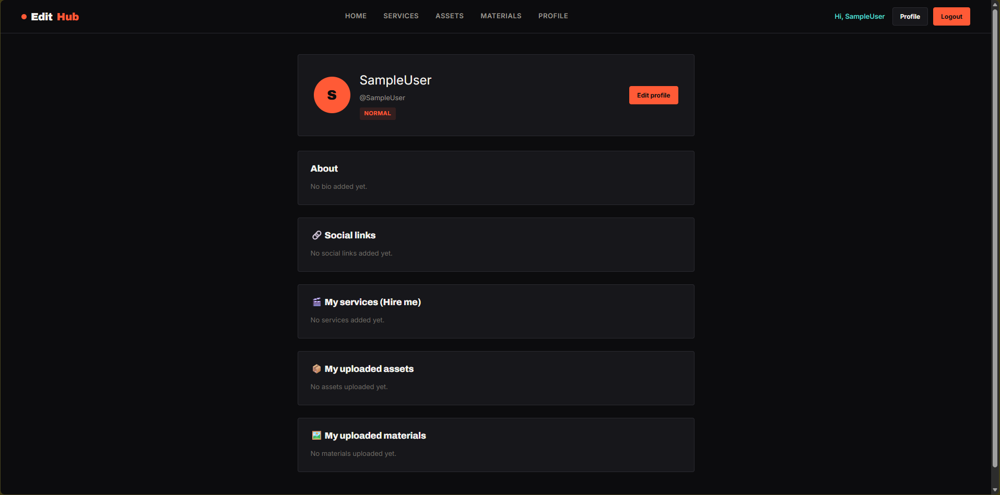
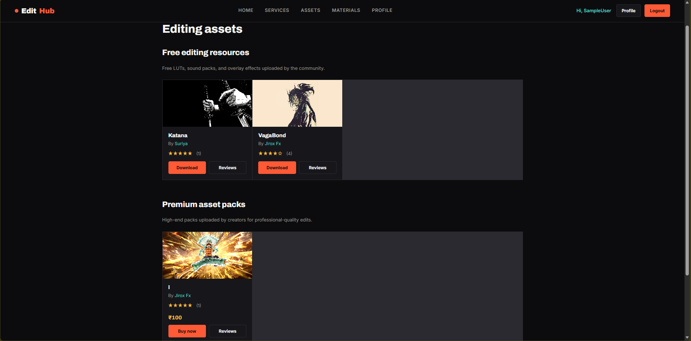
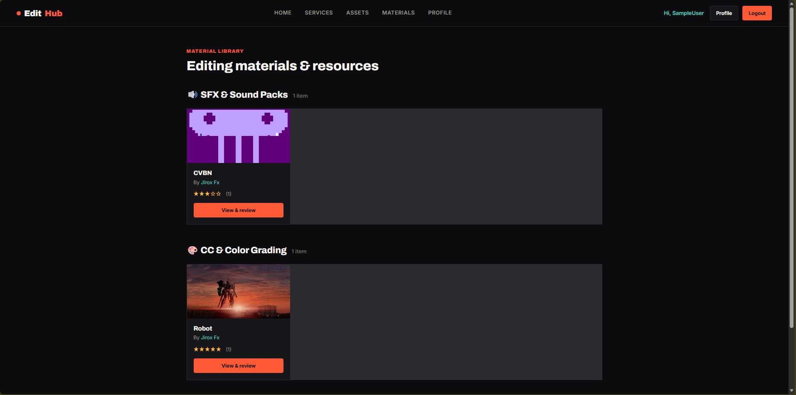
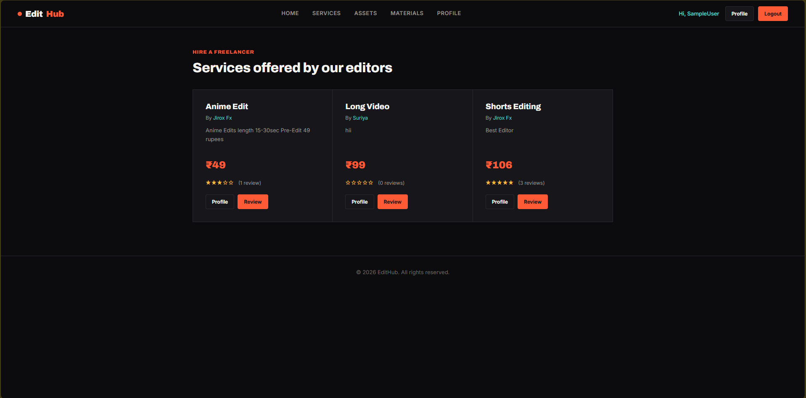
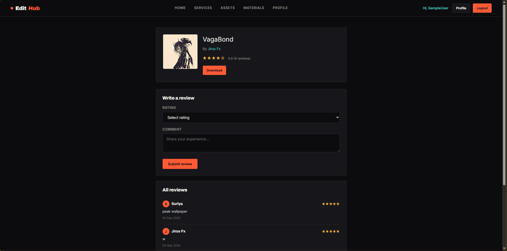

# 🎬 EditHub – Video Editing Services & Asset Marketplace

EditHub is a web-based platform that connects video editors and content creators. Users can explore editing assets and materials, showcase editing services, manage profiles, upload creative resources, and share ratings and reviews.

## ✨ Main Features

- **User Authentication:** Registration, login, logout, and password recovery.
- **Recovery Pass Phrase:** Reset account credentials using a recovery phrase.
- **User Categories:** Register as a Video Editor or Content Creator.
- **Assets Marketplace:** Browse, upload, and manage presets, templates, overlays, effects, and transitions.
- **Materials Management:** Upload, browse, and delete creative materials.
- **Hire Video Editors:** Explore editor profiles, services, and contact details.
- **Ratings and Reviews:** Rate and review assets, materials, and video editors.
- **Social Media Links:** Add and manage YouTube, Instagram, LinkedIn, and other social profiles.
- **User Profile Management:** Update profile information, category, services, and social links.
- **Search Functionality:** Find users and creative resources.

## 🛠️ Technologies / Tech Stack

| Component | Technologies |
|---|---|
| Frontend | HTML5, CSS3, JavaScript |
| Backend | PHP |
| Database | MySQL / MariaDB |
| Local Server | XAMPP, Apache |
| Database Management | phpMyAdmin |
| Version Control | Git and GitHub |

## ⚙️ Installation and Setup

### Prerequisites

- [XAMPP](https://www.apachefriends.org/)
- [Git](https://git-scm.com/)
- A web browser

### Step 1: Clone the Repository

Open Git Bash or a terminal and run:

```bash
git clone https://github.com/Jeyasuriya-pillai/EditHub.git
```

### Step 2: Move the Project to XAMPP

Place the project folder inside:

```text
C:\xampp\htdocs\EditHub
```

### Step 3: Start XAMPP Services

Open the XAMPP Control Panel and start:

- Apache
- MySQL

### Step 4: Create the Database

Open phpMyAdmin:

```text
http://localhost/phpmyadmin
```

Create a database named:

```text
edithub
```

Import the required SQL schema and tables. If a complete database export is not included in the repository, create the tables required by the application before proceeding.

### Step 5: Configure the Database

Open:

```text
php/db.php
```

Configure the database connection using your local settings. For a default XAMPP installation, the configuration may look like this:

```php
$host = "localhost";
$username = "root";
$password = "";
$database = "edithub";
```

Use the correct port if your MySQL/MariaDB server runs on a non-default port.

### Step 6: Check Upload Directories

Ensure these directories exist:

```text
uploads/
├── assets/
└── materials/
```

The web server must have permission to write uploaded files to these directories.

## ▶️ How to Run and Use the Project

1. Start Apache and MySQL from the XAMPP Control Panel.
2. Open your browser and visit:

   `http://localhost/EditHub/`

3. Register a new account.
4. Log in using your credentials.
5. Choose your category: Video Editor or Content Creator.
6. Update your profile and add social media links.
7. Browse or upload editing assets and materials.
8. Editors can add services and contact details for hiring enquiries.
9. Explore available profiles, services, assets, and materials.
10. Submit ratings and reviews where supported.

## 🔐 Environment Variables and Configuration

The current project uses a PHP database configuration file. No environment variables are required by default in the documented local setup.

If environment variables are introduced for deployment, use placeholders such as:

```env
DB_HOST=localhost
DB_PORT=3306
DB_NAME=edithub
DB_USERNAME=your_database_username
DB_PASSWORD=your_database_password
```

**Security Notes:**

- Never commit real database passwords, API keys, or other secrets to GitHub.
- Use your hosting provider's environment-variable settings for production credentials.
- Keep local configuration files containing secrets out of public repositories.

## 📸 Screenshots

### Banner Page


### Home Page


### Login Page


### Registration Page


### Password Recovery


### User Profile


### Assets Marketplace


### Materials Section


### Services / Hire Editor


### Ratings and Reviews


*Note: Screenshots will appear on GitHub when the corresponding image files exist at the specified paths.*

## 🌐 Live Deployment

**Live Website:** Add your active deployment URL here.

**GitHub Repository:**  
https://github.com/Jeyasuriya-pillai/EditHub

## 🎯 Project Objectives

- Connect video editors with content creators.
- Provide a platform for showcasing editing services.
- Make editing assets and materials easier to discover and manage.
- Enable users to maintain profiles and social media links.
- Support ratings and reviews.
- Bring creative resources and editing services together in one platform.

## 🚀 Future Improvements

- Online payment gateway
- Asset download system
- Real-time chat
- Notification system
- Advanced search and filters
- AI-based editor recommendations
- Editor analytics dashboard
- Premium asset marketplace
- Automated email notifications
- Improved mobile responsiveness

## 👨‍💻 Student / Developer Information

- **Student Name:** Jeyasuriya Thangapandi
- **Roll Number:** 19022
- **Course:** TY B.Sc. Information Technology
- **Academic Year:** 2026–2027

## 📄 License

This project is developed for educational, learning, and demonstration purposes.

## ⚠️ Disclaimer

EditHub is an educational project. Users are responsible for ensuring that any assets, materials, images, logos, or other content they upload or share comply with applicable copyright and intellectual property laws. The developer does not claim ownership of third-party content uploaded by users.
